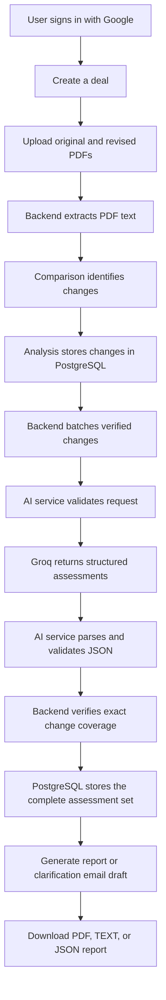
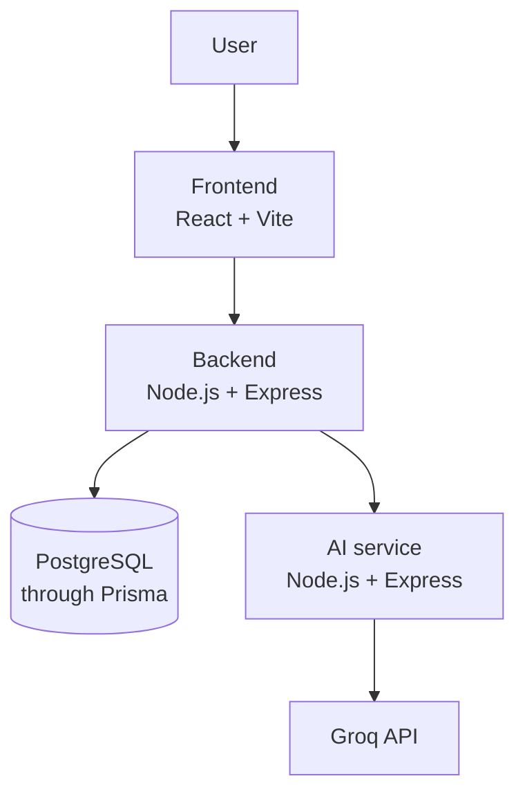

# DealLens

## Contract comparison and impact analysis for deal teams

DealLens is a full-stack platform for comparing contract documents, identifying meaningful changes, assessing their potential impact, preparing client clarification email drafts, and exporting review reports. It is designed for software demonstration and development workflows; it does not provide legal advice.

## Live application

| Component | Deployment URL |
|---|---|
| Frontend | Coming Soon — [Add Frontend URL Here] |
| Backend API | Coming Soon — [Add Backend URL Here] |
| AI service | Coming Soon — [Add AI Service URL Here] |

### Project demonstration

- YouTube Demo: Coming Soon — [Add YouTube Video URL Here]

## Key features

- **Document upload:** Authenticated users create deals and upload original, revised, or supporting PDF documents.
- **Contract comparison:** Extracted PDF text is compared to identify added, removed, and modified content.
- **Rule-based classification:** Detected changes receive categories and severity classifications.
- **AI impact analysis:** The backend sends validated change batches to the separate AI service, which requests structured assessments from Groq and validates the response.
- **Assessment persistence:** Complete assessment sets are stored with the analysis only after exact change-ID coverage is verified.
- **Client clarification email:** Users can generate, edit, save, copy, retrieve, and delete an email draft grounded in saved analysis findings.
- **Reports:** Reports include deal, document, analysis, change, severity, and AI assessment information.
- **Exports:** Reports can be downloaded as PDF, plain text, or JSON.
- **Dashboard:** The frontend presents deal, document, analysis, severity, status, and recent activity information.

## Complete workflow



## System architecture



The frontend communicates only with the backend. It never calls the AI service or Groq directly. The backend owns authentication, authorization, persistence, document processing, orchestration, and report generation. The AI service owns provider requests, prompts, structured parsing, and AI-output validation.

## Technology stack

| Area | Verified technology |
|---|---|
| Frontend | React 19, React Router, Vite, Tailwind CSS, Axios |
| Backend | Node.js, Express 5, Zod, Multer, pdf-parse, PDFKit |
| AI service | Node.js, Express, OpenAI-compatible SDK, Zod |
| Database | PostgreSQL |
| ORM | Prisma |
| AI provider | Groq OpenAI-compatible API |
| Testing | Node.js built-in test runner |
| Development | npm workspaces, Nodemon, Concurrently |

## Repository structure

```text
DealLens/
├── README.md
├── package.json
├── frontend/
│   ├── README.md
│   └── src/
├── backend/
│   ├── README.md
│   ├── prisma/schema.prisma
│   └── src/
├── ai-service/
│   ├── README.md
│   └── src/
├── sample-document/
│   ├── README.md
│   ├── SaaS-CRM-Platform/
│   ├── Fintech-Expense-Management/
│   └── Ecommerce-Multi-Vendor-Platform/
└── .gitignore
```

Runtime uploads, generated reports, dependencies, build output, secrets, and logs are intentionally omitted.

## Installation and setup

### Prerequisites

- Node.js `>=20.19.0`
- npm
- PostgreSQL
- Google OAuth credentials for authenticated local use
- A Groq API key for live AI requests

### Install

```powershell
git clone https://github.com/aryan24cse109-dev/DealLens.git
cd DealLens
npm install
```

### Configure environment

Copy the example files and fill in local values without committing them:

```powershell
Copy-Item backend\.env.example backend\.env
Copy-Item ai-service\.env.example ai-service\.env
Copy-Item frontend\.env.example frontend\.env
```

See the service READMEs for the complete variable tables. Never commit `.env` files.

### PostgreSQL and Prisma

Create a PostgreSQL database named `deallens`, set `DATABASE_URL` in `backend/.env`, then run the repository's Prisma commands from `backend/`:

```powershell
cd backend
npx prisma generate
npx prisma migrate deploy
cd ..
```

Use the migration workflow appropriate to your development environment when creating new schema changes. This documentation does not create or apply a new migration.

### Run the complete application

```powershell
npm run dev
```

Or run services individually:

```powershell
npm run dev:backend
npm run dev:ai
npm run dev:frontend
```

Local defaults are frontend `5173`, backend `5000`, and AI service `5001`.

### Test and build

```powershell
npm test
npm run build
```

## Environment variables

The authoritative variable names are in [backend/.env.example](backend/.env.example), [ai-service/.env.example](ai-service/.env.example), and [frontend/.env.example](frontend/.env.example). Important values include:

- Backend: `NODE_ENV`, `PORT`, `FRONTEND_URL`, `DATABASE_URL`, `AI_SERVICE_URL`, upload/report directories, AI timeout/retry settings, and Google/session settings.
- AI service: `PORT`, `GROQ_API_KEY`, `GROQ_BASE_URL`, `GROQ_MODEL`, `AI_SERVICE_API_KEY`, provider timeout settings, and `AI_MAX_CHANGES`.
- Frontend: `VITE_API_BASE_URL`.

Use values such as `GROQ_API_KEY=your_groq_api_key_here` in documentation or deployment configuration. Do not expose real keys.

## AI provider and free-tier limitations

DealLens currently uses Groq with the configured `openai/gpt-oss-120b` model for local development and free-tier usage. Provider limits are external to DealLens:

1. Groq applies provider-defined request and token limits.
2. Larger documents produce more changes and require more AI processing.
3. DealLens processes changes in sequential batches, increasing request count.
4. Large analyses can exceed token-per-minute, token-per-day, or request limits.
5. Rate limiting can return HTTP 429.
6. Provider or service failures can also appear as HTTP 5xx responses.
7. Bounded retry, timeout, and reset-header handling cannot bypass provider quotas.
8. A small successful analysis does not guarantee completion of every large analysis.
9. Production use requires quota planning, monitoring, and an appropriate provider plan.

This is a known limitation of the current local/free-tier configuration and does not by itself mean the application architecture is broken. DealLens does not promise unlimited AI processing or guaranteed completion.

## Sample documents

The [Sample Documents Guide](sample-document/README.md) describes the planned short fictional contract pairs:

- SaaS CRM Platform
- Fintech Expense Management
- E-commerce Multi-Vendor Platform

Each revised PDF will correspond to its matching original PDF. Upload the matching pair to a new deal to demonstrate comparison and impact analysis. The documents are for software demonstration and testing only, not legal advice or real contractual use.

## Testing

Run the backend and AI-service suites with:

```powershell
npm test
```

The tests cover authentication boundaries, comparison behavior, batching, retries, rate-limit metadata, JSON validation, assessment ID coverage, reports, and communication workflows. Build the frontend with `npm run build`.

## Known limitations

- Groq free-tier quota and rate limits can prevent large analyses from completing.
- Large documents require more extraction, comparison, batching, and provider time.
- Deployment URLs are not yet specified.
- The project currently uses Google OAuth rather than a local password flow.
- AI output is an assessment aid and is not legal advice.

## Future improvements

Potential future work includes deployment configuration, provider quota monitoring, distributed job processing, durable progress events, and additional sample-document content. These are plans, not currently implemented features.

## Contribution, license, and contact

Contributions should preserve the frontend → backend → AI-service boundary, authentication ownership checks, strict output validation, and safe secret handling. No open-source license has yet been specified for this repository. Contact and support details will be added with the deployment information.

## Service documentation

- [Frontend README](frontend/README.md)
- [Backend README](backend/README.md)
- [AI Service README](ai-service/README.md)
- [Sample Documents Guide](sample-document/README.md)
