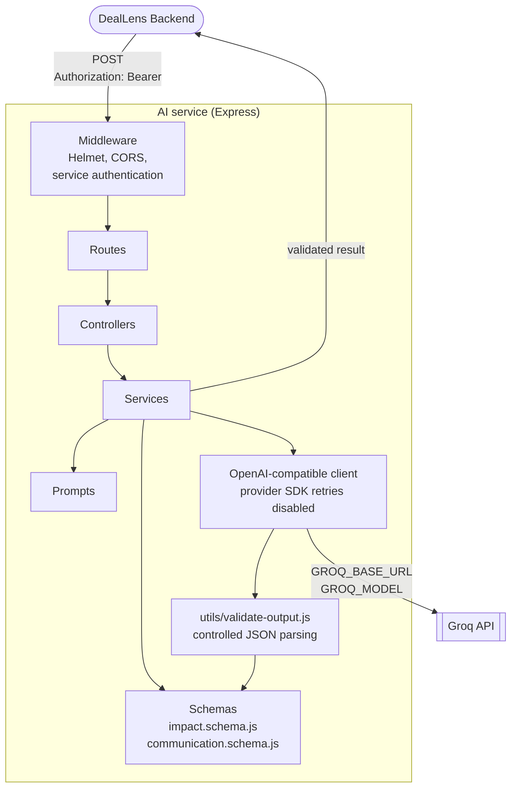

<div align="center">

# DealLens AI Service

**A separate Express service that turns contract changes into validated impact assessments and client email drafts through the Groq API.**


</div>

> [!NOTE]
> Items written as `[CONFIRM: ...]` or `[ADD ...]` are not yet verified against the source code or deployment settings. Replace or remove them before publishing. See the [documentation checklist](#documentation-checklist) at the end of this file.

## Table of contents

1. [AI service overview](#ai-service-overview)
2. [Responsibilities and scope](#responsibilities-and-scope)
3. [Architecture](#architecture)
4. [AI analysis workflow](#ai-analysis-workflow)
5. [AI provider integration](#ai-provider-integration)
6. [Rate limits and free-tier constraints](#rate-limits-and-free-tier-constraints)
7. [Input and output contracts](#input-and-output-contracts)
8. [Error handling](#error-handling)
9. [Environment variables](#environment-variables)
10. [Local installation](#local-installation)
11. [Running and testing](#running-and-testing)
12. [Health check](#health-check)
13. [Deployment](#deployment)
14. [Security](#security)
15. [Limitations and future improvements](#limitations-and-future-improvements)
16. [Documentation checklist](#documentation-checklist)

---

## AI service overview

The AI service is a separate Express process that isolates LLM provider integration from the rest of DealLens. It authenticates internal requests from the backend, builds prompts, calls the Groq OpenAI-compatible API, parses the model's structured output, and validates it against schemas before returning it.

**AI Service URL:** `[ADD AI SERVICE URL]`

> [!IMPORTANT]
> This is an **API-integrated** AI service. It does not train, fine-tune, or host a model. All inference is performed by the external Groq API, and the AI output is an assessment aid, not legal advice.

The backend calls this service. The frontend never calls it directly.

---

## Responsibilities and scope

| In scope | Out of scope |
|---|---|
| Authenticate backend requests | Users, sessions, and OAuth (owned by the backend) |
| Validate requests, including the bounded change list | Storing deals, documents, analyses, or reports |
| Build prompts for impact analysis and communication drafts | PDF extraction and document comparison |
| Call Groq through an OpenAI-compatible client | Splitting large change sets into batches (owned by the backend) |
| Parse and validate model output | Retrying failed requests (owned by the backend) |
| Return sanitized provider diagnostics and retry metadata | Sending email |

### Why it is separate

Separating provider work keeps Groq credentials and provider-specific behaviour out of the browser and the primary persistence API. It also gives the AI workflows their own prompts, schemas, provider timeout, diagnostics, and service-authentication boundary.

> [!NOTE]
> `[CONFIRM: stateless]` The documentation lists no database or storage for this service and assigns persistence to the backend. Confirm that the service keeps no state between requests before describing it as stateless.

---

## Architecture

`src/server.js` listens on the configured port. `src/app.js` exposes the health route, the internal AI routes, and sanitized error handling.

```text
ai-service/
├── README.md
├── package.json
└── src/
    ├── app.js
    ├── server.js
    ├── config/
    ├── controllers/
    ├── middleware/
    ├── prompts/
    ├── routes/
    ├── schemas/
    ├── services/
    └── utils/
```



| Layer | Location | Role |
|---|---|---|
| **Routes** | `src/routes/` | Health and internal AI routes. |
| **Middleware** | `src/middleware/` | Service authentication with the bearer credential. |
| **Controllers** | `src/controllers/` | Handle requests and responses. |
| **Services** | `src/services/` | Workflow logic and provider calls. |
| **Prompts** | `src/prompts/` | Prompt construction for impact analysis and communications. |
| **Schemas** | `src/schemas/` | `impact.schema.js` validates verified changes and assessment output. `communication.schema.js` validates communication requests and generated content. |
| **Validation utility** | `src/utils/validate-output.js` | Controlled JSON parsing that does not invent missing fields or accept truncated output. |
| **Config** | `src/config/` | Environment-driven configuration. |

> [!NOTE]
> `[CONFIRM: file names]` Add the actual route, controller, service, and prompt file names. The documentation names only the two schema files and `validate-output.js`.

---

## AI analysis workflow

### Impact analysis

`POST /api/v1/ai/impact-analysis`

1. **Authenticate** the backend request using the bearer credential.
2. **Validate** the request and its bounded change list.
3. **Build** the impact-analysis prompt.
4. **Request** one assessment per supplied change from Groq.
5. **Parse** the complete JSON, including safely recoverable fenced or surrounded JSON.
6. **Validate** required fields, enums, types, and confidence.
7. **Reject** missing, duplicate, or unexpected change IDs.
8. **Return** the validated assessment collection to the backend.

Batch splitting is coordinated by the backend, so each request to this service is bounded. The service itself enforces a maximum request change count (`AI_MAX_CHANGES`).

### Communication generation

`POST /api/v1/ai/communications`

- The service receives trusted analysis context and optional instructions from the backend.
- The model generates the subject and body of a client clarification email.
- Application-supplied communication metadata remains authoritative.
- Generated content is validated before it is returned for persistence by the backend.
- No email is sent.

> [!NOTE]
> `[CONFIRM: communication workflow steps]` Add the numbered steps for this workflow once the source is reviewed, in the same style as impact analysis.

---

## AI provider integration

| Item | Details |
|---|---|
| **Provider** | Groq |
| **API style** | OpenAI-compatible, used through an OpenAI-compatible SDK |
| **Endpoint** | The configured `GROQ_BASE_URL` |
| **Model** | The configured `GROQ_MODEL`. The current model is `openai/gpt-oss-120b`. |
| **Credential** | `GROQ_API_KEY`, kept server-side in this service only |
| **SDK retries** | Disabled, so retry ownership stays at the backend boundary |
| **Timeout** | The configured provider timeout (`AI_REQUEST_TIMEOUT_MS`) |

### Structured output handling

- **Impact analysis** disables the provider's JSON mode. The service performs strict local parsing and validation instead.
- **Communication generation** uses the configured structured response workflow.

`[CONFIRM: what "structured response workflow" means in the code]`

### Provider diagnostics

Provider errors are converted into sanitized service diagnostics that contain status, type, code, message, retry metadata, model, and endpoint. API keys, authorization headers, prompts, and contract content are not logged.

---

## Rate limits and free-tier constraints

DealLens depends on the Groq API. Its availability and speed are determined by Groq and by your Groq account, not by this service.

- **Limits are account and model specific.** Groq applies request and token limits that depend on your account, plan, and the selected model.
- **Requests may be delayed, throttled, or rejected.** When a limit is reached, Groq can return HTTP `429`. The reset window can be longer than the maximum synchronous wait this service is configured to allow.
- **Free-tier quotas can change.** Quotas and token limits follow Groq's policies, which can change without notice. This README does not state current numbers.
- **Large documents consume more tokens.** More changes produce more sequential batches, which means more requests and more tokens. Repeated analyses of the same document consume tokens again.
- **Retries and timeouts help but are bounded.** Provider SDK retries are disabled here. The service applies its configured provider timeout and exposes sanitized retry and reset metadata to the backend. The backend owns bounded retries and does not retry before a reset window allows. Retries cannot bypass token-per-minute, token-per-day, or request quotas.
- **Small success is not a guarantee.** A small request that succeeds does not mean a large analysis will fit your current quotas.
- **Availability is external.** Provider outages and 5xx errors can interrupt AI features.
- **You can use your own key.** Set your own Groq key in `GROQ_API_KEY` in `ai-service/.env`. A key with higher limits can raise the ceiling, but it does not remove it.

DealLens does not promise unlimited free usage or guaranteed completion. For production, plan quotas, monitor usage, and choose a provider plan that fits your workload.

> [!TIP]
> For current rate limits, see the official Groq documentation: <https://console.groq.com/docs/rate-limits>

---

## Input and output contracts

> [!NOTE]
> `[CONFIRM: request and response schemas]` Exact field names and types come from `src/schemas/impact.schema.js` and `src/schemas/communication.schema.js`. They are not reproduced here because they have not been verified, and the examples are omitted so that nothing is documented that does not match the schemas. Add the tables and examples once confirmed.

### Impact analysis

| | Documented behaviour |
|---|---|
| **Request** | A validated, bounded list of verified changes. The maximum count is `AI_MAX_CHANGES`. `[CONFIRM: field names, required and optional fields, and any context fields]` |
| **Response** | A validated collection with one assessment per supplied change. |
| **Assessment fields** | The assessment requires `changeId`, category, impact, explanation, suggested action, severity, and confidence. `[CONFIRM: exact key names, enum values for category and severity, and the confidence range]` |
| **Guarantees** | Missing, duplicate, and unexpected change IDs are rejected. Malformed assessments are not silently discarded. |

### Communications

| | Documented behaviour |
|---|---|
| **Request** | Trusted analysis context from the backend, plus optional instructions. `[CONFIRM: field names]` |
| **Response** | Generated subject and body content, validated against the communication schema. |
| **Metadata** | Application-supplied communication metadata remains authoritative over model output. |

### Authentication header

```http
Authorization: Bearer <AI_SERVICE_API_KEY>
```

---

## Error handling

`src/app.js` provides sanitized error handling, so responses and logs do not expose secrets, prompts, or contract content.

| Category | Behaviour |
|---|---|
| **Validation errors** | Requests that fail schema validation, including change lists over the maximum, are rejected before any provider call. |
| **Authentication errors** | Requests without the correct bearer credential are rejected. |
| **Provider errors** | Converted to sanitized diagnostics: status, type, code, message, retry metadata, model, and endpoint. |
| **Rate-limit errors** | Groq `429` responses are reported with retry and reset metadata. The reset window can exceed the maximum synchronous wait, so the backend is told the failure is retryable instead of the service waiting. |
| **Timeouts** | The configured provider timeout applies. Retrying is the backend's responsibility. |
| **Malformed responses** | Invalid or truncated JSON, schema-incompatible output, and missing, duplicate, or unexpected change IDs are rejected. The service does not fabricate missing fields. Fenced or surrounded JSON is safely recovered when possible. |

> [!NOTE]
> `[CONFIRM: HTTP status codes and error body]` Add the status code the service returns for each category and the shape of the error response.

---

## Environment variables

The authoritative names are in `ai-service/.env.example`.

> [!WARNING]
> The values below are placeholders. Use real values only in an untracked `ai-service/.env`. Never commit credentials.

| Variable | Purpose |
|---|---|
| `NODE_ENV`, `PORT` | Runtime mode and service port |
| `GROQ_API_KEY` | Server-side Groq credential |
| `GROQ_BASE_URL` | OpenAI-compatible provider base URL |
| `GROQ_MODEL` | Provider model name |
| `AI_SERVICE_API_KEY` | Backend-to-service bearer credential |
| `AI_REQUEST_TIMEOUT_MS` | Provider request timeout |
| `AI_MAX_SYNCHRONOUS_RETRY_WAIT_MS` | Maximum synchronous reset wait |
| `AI_MAX_CHANGES` | Maximum changes accepted per request |

```dotenv
NODE_ENV=development
PORT=5001
GROQ_API_KEY=your_groq_api_key_here
GROQ_BASE_URL=your_openai_compatible_base_url
GROQ_MODEL=openai/gpt-oss-120b
AI_SERVICE_API_KEY=your_shared_service_key_here
AI_REQUEST_TIMEOUT_MS=your_provider_timeout_in_ms
AI_MAX_SYNCHRONOUS_RETRY_WAIT_MS=your_max_wait_in_ms
AI_MAX_CHANGES=your_max_changes_per_request
```

`AI_SERVICE_API_KEY` must be identical in `ai-service/.env` and in the backend's `backend/.env`.

`[CONFIRM: default values, and whether the service fails at startup when a required variable is missing]`

---

## Local installation

### Prerequisites

- Node.js `>=20.19.0` and npm
- A Groq API key
- The DealLens backend, if you want to run the full application

### Install

From the repository root (npm workspaces):

```bash
npm install
```

### Configure

**macOS / Linux**

```bash
cp ai-service/.env.example ai-service/.env
```

**Windows (PowerShell)**

```powershell
Copy-Item ai-service\.env.example ai-service\.env
```

Edit `ai-service/.env` with your own values.

---

## Running and testing

### Run

From the repository root:

```bash
npm run dev:ai
```

Or from `ai-service/`:

```bash
npm run dev     # development
npm start       # standard start
```

The default local port is `5001`.

### Test

```bash
cd ai-service
npm test
```

The tests cover service authentication, communication metadata, valid and fenced JSON, invalid and truncated JSON, schema incompatibility, and exact change-ID validation.

### Troubleshooting

- Confirm `GROQ_API_KEY`, `GROQ_BASE_URL`, and `GROQ_MODEL` are set in the untracked environment file.
- Confirm the backend uses the same `AI_SERVICE_API_KEY`.
- Check the service log for sanitized provider status and reset information.
- For HTTP `429`, stop repeated requests and wait for the provider reset window.
- Do not treat generated assessments as legal advice or guaranteed legal interpretation.

---

## Health check

| Method | Path | Authentication | Purpose |
|---|---|---|---|
| GET | `/health` | None | Service health response |

```bash
curl http://localhost:5001/health
```

`[CONFIRM: response body and status code]` The documentation says only that the route returns a service health response. It is not documented as checking the Groq connection, so do not assume it does.

**Deployed AI service URL:** `[ADD AI SERVICE URL]`

---

## Deployment

> [!NOTE]
> `[CONFIRM: Render configuration]` The project documentation does not describe the deployment of this service. If it is deployed on Render, add the verified settings: service type, root directory, build and start commands, environment variables, and health check path. Otherwise remove this note.

### Deployment requirements

| Requirement | Details |
|---|---|
| **Start command** | `npm start` |
| **Environment** | All variables in [Environment variables](#environment-variables), set in the host's settings and not in committed files |
| **Credential match** | `AI_SERVICE_API_KEY` identical to the backend's value |
| **Backend configuration** | The backend's `AI_SERVICE_URL` must point to this service |
| **Network exposure** | `[CONFIRM: whether the service is public or internal only]` |

The service is intended for backend-to-service calls only. The frontend never calls it.

---

## Security

The following measures are described in the project documentation. This is not a security certification.

| Area | Measure |
|---|---|
| **Service authentication** | The AI routes require `Authorization: Bearer <AI_SERVICE_API_KEY>`. `/health` is unauthenticated. |
| **Provider credential** | `GROQ_API_KEY` stays server-side in this service and never reaches the browser. |
| **HTTP hardening** | Helmet and CORS are used. `[CONFIRM: CORS configuration]` |
| **Input validation** | Requests are validated with Zod, and the change list is bounded. |
| **Output validation** | Model output is parsed and validated before it is returned. |
| **Logging and errors** | Keys, authorization headers, prompts, and contract content are not logged. Provider errors are sanitized. |
| **Secrets** | Use untracked `.env` files and placeholders in documentation. Never commit real keys. |

> [!CAUTION]
> Contract content in requests is sent to Groq, an external provider. Review its data handling terms before processing confidential agreements.

---

## Limitations and future improvements

### Current limitations

- **External dependency.** All inference runs on Groq, so availability and limits are outside this service's control.
- **Provider quotas.** Large or repeated analyses can hit rate limits and fail.
- **Bounded requests.** Each impact request is limited by `AI_MAX_CHANGES`. Large analyses need many sequential batches from the backend.
- **No provider JSON mode for impact analysis.** The service relies on strict local parsing and validation instead.
- **Strict rejection.** Malformed, truncated, or incomplete model output is rejected, not repaired, so some requests will fail rather than return partial results.
- **Not legal advice.** Assessments are an aid and not a legal interpretation.

### Future improvements

The project's planned work includes provider quota monitoring, distributed job processing, and durable progress events. These are plans and are not implemented. `[CONFIRM: add AI-service-specific items, such as other providers or response caching, only if planned]`

---

## Documentation checklist

Remove this section when every item is resolved.

- [ ] Add the request and response schemas and example payloads from the schema files.
- [ ] Confirm exact assessment key names, and the category, severity, and confidence values.
- [ ] Add numbered steps for the communication workflow.
- [ ] Confirm the HTTP status codes and error body for each error category.
- [ ] Confirm the `/health` response.
- [ ] Confirm the service is stateless.
- [ ] Add actual route, controller, service, and prompt file names.
- [ ] Add environment variable defaults and startup validation.
- [ ] Confirm CORS configuration and network exposure.
- [ ] Add the Render settings, or remove the note.
- [ ] Replace `[ADD AI SERVICE URL]`.

---

Back to the [root README](../README.md) · [Frontend README](../frontend/README.md) · [Backend README](../backend/README.md)
