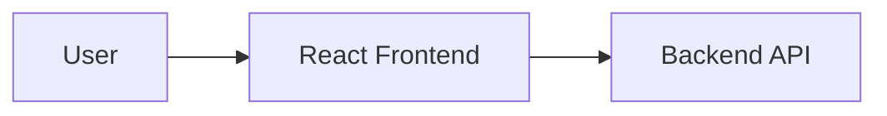

# DealLens Frontend

## Overview

The DealLens frontend is a React single-page application built with Vite. It provides authenticated screens for deal management, document upload, contract comparison, AI analysis, client clarification email drafts, dashboard metrics, and report downloads.

**Frontend Deployment URL:** Coming Soon — [Add Frontend URL Here]

The frontend communicates only with the backend API. It never calls the AI service or Groq directly.



## Technology and structure

- React 19
- React Router
- Vite
- Tailwind CSS
- Axios
- Lucide React icons

```text
frontend/
├── README.md
├── package.json
├── vite.config.js
└── src/
    ├── App.jsx
    ├── main.jsx
    ├── index.css
    ├── components/
    │   ├── auth/
    │   └── layout/
    ├── layouts/
    ├── pages/
    │   ├── LoginPage.jsx
    │   ├── DashboardPage.jsx
    │   ├── UploadPage.jsx
    │   ├── ComparisonPage.jsx
    │   ├── AnalysisPage.jsx
    │   ├── CommunicationPage.jsx
    │   └── ReportPage.jsx
    └── services/api.js
```

The entry point is `src/main.jsx`; routing is defined in `src/App.jsx`.

## Routes and pages

| Route | Purpose |
|---|---|
| `/login` | Google sign-in entry point |
| `/dashboard` | Deal and analysis overview |
| `/upload` | Deal creation and document upload |
| `/comparison` | Compare selected documents |
| `/analyse/:analysisId` | View and run persisted impact analysis |
| `/communication` | Generate and edit a clarification email draft |
| `/report` | Generate and download reports |

Protected routes are wrapped by the authentication guard and main layout.

## Main workflows

### Authentication

The login page redirects to the backend Google OAuth start route. The backend owns OAuth state, session cookies, and authorization. The frontend retrieves the current session through the backend API and does not handle provider secrets.

### API communication

`src/services/api.js` creates the Axios client using `VITE_API_BASE_URL` and sends credentials for the backend session. API errors are surfaced in page-level error states.

### Upload and comparison

The upload page creates a deal, uploads original and revised PDFs to the backend, and starts the comparison workflow. The comparison page displays detected changes and can start the AI impact workflow.

### Analysis

The analysis page loads a persisted analysis, displays changes and assessments, prevents duplicate submissions while a request is active, and presents truthful long-running progress and error messages. The backend performs token-aware sequential batching.

### Client clarification email

The communication page generates a client clarification email from saved analysis findings. The subject and body remain editable. Users can regenerate, save edits, copy the draft, retrieve it after refresh, or delete it.

### Reports

The report page requests PDF, TEXT, or JSON report generation through the backend and downloads the returned file. The frontend does not generate reports or contact the AI service.

## Environment

Create `frontend/.env` from `frontend/.env.example`:

```dotenv
VITE_API_BASE_URL=http://localhost:5000/api/v1
```

Do not put API keys, OAuth secrets, database URLs, or Groq configuration in frontend environment variables.

## Installation and commands

From the repository root:

```powershell
npm install
npm run dev:frontend
```

Or from this directory:

```powershell
npm run dev
npm run build
npm run preview
```

The Vite development server uses port `5173` by default.

## Testing and troubleshooting

The frontend package currently defines development, build, and preview scripts but no dedicated frontend test script. Use `npm run build` to validate the production bundle.

Common checks:

- Confirm the backend is running at the URL configured by `VITE_API_BASE_URL`.
- Confirm browser credentials/cookies are allowed for the backend origin.
- Confirm Google OAuth callback and frontend redirect values match the backend configuration.
- Inspect the browser network panel for authenticated API responses.
- Large analyses may take longer or fail when Groq quota is exhausted; this is a provider limitation rather than a frontend-only error.
