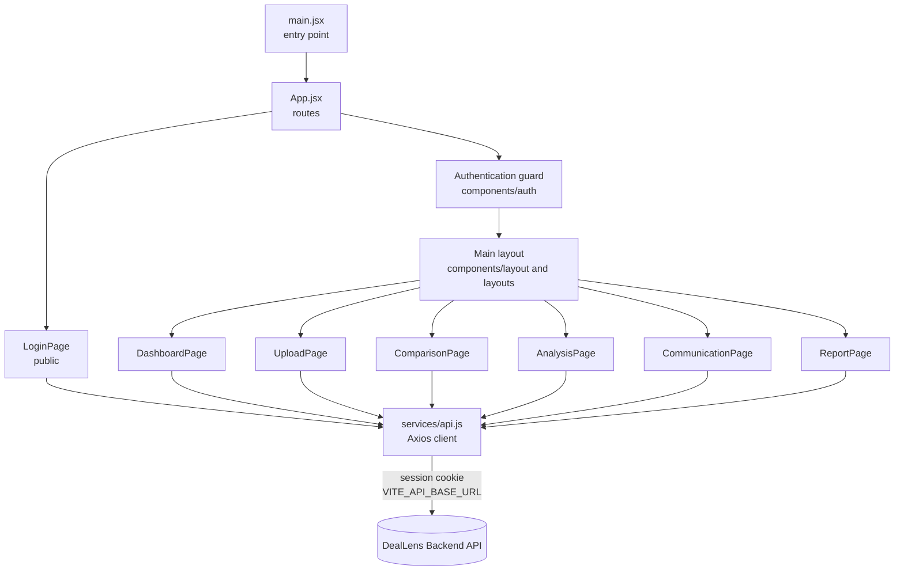

<div align="center">

# DealLens Frontend

**The React single-page application for DealLens: sign in, upload, compare, analyse, draft, and report.**


</div>

> [!NOTE]
> Items written as `[CONFIRM: ...]` or `[ADD ...]` are not yet verified against the source code or deployment settings. Replace or remove them before publishing. See the [documentation checklist](#documentation-checklist) at the end of this file.

## Table of contents

1. [Frontend overview](#frontend-overview)
2. [Frontend features](#frontend-features)
3. [Application architecture](#application-architecture)
4. [Routing](#routing)
5. [Backend integration](#backend-integration)
6. [Installation](#installation)
7. [Environment variables](#environment-variables)
8. [Project structure](#project-structure)
9. [Deployment](#deployment)
10. [Troubleshooting](#troubleshooting)
11. [Limitations and future improvements](#limitations-and-future-improvements)
12. [Documentation checklist](#documentation-checklist)

---

## Frontend overview

The DealLens frontend is a React single-page application built with Vite. It gives authenticated users the screens they need to manage deals and run the DealLens workflow: uploading contract PDFs, reviewing detected changes, running AI impact analysis, preparing client clarification emails, and downloading reports.

It is a thin client. It displays data and sends requests, and it leaves processing, persistence, and AI work to the backend.

### Responsibilities

| The frontend does | The frontend does not |
|---|---|
| Render pages, forms, and results | Extract PDF text or compare documents |
| Start Google sign-in by redirecting to the backend | Handle OAuth secrets or issue sessions |
| Call the backend API with the session cookie | Call the AI service or Groq directly |
| Show loading, progress, and error states | Generate reports (it requests them and downloads the file) |
| Let users edit and copy email drafts | Send email |

### Technologies

| Technology | Role |
|---|---|
| React 19 | UI library |
| React Router | Client-side routing |
| Vite | Development server and production bundler |
| Tailwind CSS | Styling |
| Axios | HTTP client for the backend API |
| Lucide React | Icons |

---

## Frontend features

Only features described in the project documentation are listed.

| Feature | What it does | Page |
|---|---|---|
| **Login and authentication** | A login page redirects the browser to the backend's Google OAuth start route. After sign-in, the frontend reads the current session from the backend. | `LoginPage.jsx` |
| **Dashboard** | Overview of deals and analyses, including severity, status, and recent activity. | `DashboardPage.jsx` |
| **New deal and document upload** | Create a deal, upload the original and revised PDFs to the backend, and start the comparison workflow. | `UploadPage.jsx` |
| **Document comparison** | Shows the changes detected between the selected documents and can start the AI impact workflow. | `ComparisonPage.jsx` |
| **AI analysis** | Loads a saved analysis, shows its changes and AI assessments, blocks duplicate submissions while a request is running, and displays progress and error messages for long-running requests. | `AnalysisPage.jsx` |
| **Client clarification email** | Generates an email draft from saved analysis findings. The subject and body are editable. Users can regenerate, save edits, copy, retrieve the draft after a refresh, and delete it. | `CommunicationPage.jsx` |
| **Reports** | Requests a PDF, TEXT, or JSON report from the backend and downloads the returned file. | `ReportPage.jsx` |
| **Error handling** | API errors are shown in page-level error states. | All pages |

> [!NOTE]
> `[CONFIRM: Saved Deals, Saved Reports, Saved Drafts, and Settings screens]` The project documentation does not describe dedicated pages for these. If they exist in the source, add them to this table and to [Routing](#routing). If not, leave them out.
>
> `[CONFIRM: Responsive interface]` Tailwind CSS is used, but this README does not claim responsive behaviour until it is confirmed.

---

## Application architecture

The application starts at `src/main.jsx`, which mounts the app. `src/App.jsx` defines the routes. Protected routes are wrapped in an authentication guard and a main layout. Pages call the backend through a shared Axios client in `src/services/api.js`.



| Layer | Location | Responsibility |
|---|---|---|
| **Entry point** | `src/main.jsx` | Mounts the React application. |
| **Routing** | `src/App.jsx` | Declares the routes and wraps protected ones. |
| **Pages** | `src/pages/` | One component per screen. |
| **Layouts** | `src/layouts/`, `src/components/layout/` | Shared page chrome for authenticated screens. |
| **Auth components** | `src/components/auth/` | The authentication guard for protected routes. |
| **Services** | `src/services/api.js` | The configured Axios client for backend requests. |
| **Styling** | `src/index.css` | Global styles and Tailwind CSS. |

> [!NOTE]
> `[CONFIRM: Contexts and utilities]` The documentation does not mention React context providers or a `utils/` directory. If they exist, describe them here and add them to the diagram, for example an authentication context that holds the current user.

---

## Routing

Routes are defined in `src/App.jsx`.

| Route | Page | Purpose | Access |
|---|---|---|---|
| `/login` | `LoginPage` | Google sign-in entry point | Public |
| `/dashboard` | `DashboardPage` | Deal and analysis overview | Protected |
| `/upload` | `UploadPage` | Deal creation and document upload | Protected |
| `/comparison` | `ComparisonPage` | Compare selected documents | Protected |
| `/analyse/:analysisId` | `AnalysisPage` | View and run a persisted impact analysis | Protected |
| `/communication` | `CommunicationPage` | Generate and edit a clarification email draft | Protected |
| `/report` | `ReportPage` | Generate and download reports | Protected |

### Protected routes

Protected routes are wrapped by the authentication guard and the main layout. The guard decides whether the user has a valid backend session before the page is shown.

> [!NOTE]
> `[CONFIRM: Redirect behaviour]` Add the exact behaviour from `App.jsx` and the guard: where an unauthenticated user is sent (presumably `/login`), where a signed-in user lands after login, what happens on `/` and on unknown paths, and what the guard shows while the session is being checked.

---

## Backend integration

### API client

`src/services/api.js` creates a single Axios instance:

- The base URL comes from `VITE_API_BASE_URL`.
- Requests send credentials, so the browser includes the backend session cookie.

### Authentication and session handling

The backend owns OAuth state, session cookies, and authorization. The frontend:

1. Redirects the browser from the login page to the backend's Google OAuth start route.
2. Lets the backend complete the OAuth callback and redirect the user back to the frontend.
3. Retrieves the current session through the backend API.

The frontend never sees provider secrets, and it does not store tokens itself.

### Backend capabilities the pages rely on

All backend routes use the `/api/v1` prefix. Full details are in the [Backend README](../backend/README.md).

| Frontend area | Backend routes (see the backend README) |
|---|---|
| Sign-in and session | `GET /auth/google`, `GET /auth/google/callback`, `GET /auth/me`, `POST /auth/logout` |
| Dashboard | `GET /dashboard` |
| Deals and upload | `/deals`, `POST /deals/:dealId/documents` |
| Comparison | `POST /comparisons/compare` |
| Analysis | `GET /analyses/:analysisId`, `POST /analyses/:analysisId/ai-impact` |
| Communication drafts | `/analyses/:analysisId/communications`, `/communications/:draftId` |
| Reports | `/analyses/:analysisId/reports`, `GET /reports/:reportId/download` |

The frontend never calls the AI service. AI work happens behind the backend.

> [!NOTE]
> `[CONFIRM: exact endpoints called by each page]` The table lists backend routes that support each area. Adjust it to the calls actually made in the source, and note whether the logout route is used.

### Error handling

API errors are displayed in page-level error states. For analysis, the page prevents duplicate submissions while a request is active and shows progress and error messages suited to long-running requests. The backend performs the token-aware sequential batching.

---

## Installation

### Prerequisites

- **Node.js** `>=20.19.0` and **npm**
- The DealLens **backend** running and reachable (see the [Backend README](../backend/README.md))

### Install dependencies

From the repository root, which uses npm workspaces:

```bash
npm install
```

### Run in development

From the repository root:

```bash
npm run dev:frontend
```

Or from the `frontend/` directory:

```bash
npm run dev
```

The Vite development server uses port `5173` by default.

### Production build and preview

```bash
npm run build     # create the production bundle
npm run preview   # serve the built bundle locally
```

---

## Environment variables

Create `frontend/.env` from `frontend/.env.example`.

**macOS / Linux**

```bash
cp .env.example .env
```

**Windows (PowerShell)**

```powershell
Copy-Item .env.example .env
```

| Variable | Purpose | Local example |
|---|---|---|
| `VITE_API_BASE_URL` | Base URL of the backend API, including the `/api/v1` prefix | `http://localhost:5000/api/v1` |

```dotenv
# Local development
VITE_API_BASE_URL=http://localhost:5000/api/v1

# Deployed backend (replace with your backend URL)
# VITE_API_BASE_URL=[ADD BACKEND URL]/api/v1
```

> [!WARNING]
> Vite embeds `VITE_` variables in the browser bundle, so they are public. Do not put API keys, OAuth secrets, database URLs, or Groq configuration in the frontend environment.

Because Vite reads variables at build time, rebuild or restart the dev server after changing `.env`.

> [!NOTE]
> `[CONFIRM: other variables]` `VITE_API_BASE_URL` is the only frontend variable in the project documentation. Add any others found in `frontend/.env.example`.

---

## Project structure

```text
frontend/
├── README.md
├── package.json
├── vite.config.js
└── src/
    ├── App.jsx            # Route definitions
    ├── main.jsx           # Application entry point
    ├── index.css          # Global styles and Tailwind CSS
    ├── components/
    │   ├── auth/          # Authentication guard
    │   └── layout/        # Layout components
    ├── layouts/           # Page layouts
    ├── pages/
    │   ├── LoginPage.jsx
    │   ├── DashboardPage.jsx
    │   ├── UploadPage.jsx
    │   ├── ComparisonPage.jsx
    │   ├── AnalysisPage.jsx
    │   ├── CommunicationPage.jsx
    │   └── ReportPage.jsx
    └── services/
        └── api.js         # Axios client
```

| Path | Purpose |
|---|---|
| `package.json` | Dependencies and the `dev`, `build`, and `preview` scripts. |
| `vite.config.js` | Vite configuration. |
| `src/pages/` | One file per screen. |
| `src/services/api.js` | Axios client built from `VITE_API_BASE_URL`. |

---

## Deployment

> [!NOTE]
> `[CONFIRM: Vercel configuration]` The project documentation does not describe the Vercel setup. Fill in this section from the actual `vercel.json` and the Vercel project settings.

**Live frontend:** `[ADD FRONTEND URL]`

| Setting | Value |
|---|---|
| Framework preset | `[CONFIRM: Vite]` |
| Root directory | `[CONFIRM: frontend]` |
| Install command | `[CONFIRM]` |
| Build command | `[CONFIRM: npm run build]` |
| Output directory | `[CONFIRM: dist is Vite's default unless vite.config.js changes it]` |
| Environment variable | `VITE_API_BASE_URL` set to the deployed backend URL plus `/api/v1` |
| SPA rewrite to `index.html` | `[CONFIRM: configured in vercel.json?]` |

### Deployment checklist

For sign-in to work in production, these backend values must match the deployed frontend and backend (names are from the [Backend README](../backend/README.md)):

- `FRONTEND_URL` is the deployed frontend origin.
- `GOOGLE_CALLBACK_URL` matches the redirect URI registered in your Google OAuth client.
- `GOOGLE_SUCCESS_REDIRECT` points to the deployed frontend.
- `SESSION_COOKIE_SECURE` and `SESSION_COOKIE_SAMESITE` suit the deployment, especially when the frontend and backend are on different domains.

---

## Troubleshooting

### Backend connection problems

- Confirm the backend is running and that `VITE_API_BASE_URL` points to it, including `/api/v1`.
- Open the browser network panel and check that requests go to the expected host and port.
- If requests fail with CORS errors, check that the backend's `FRONTEND_URL` matches the exact origin of the frontend.

### Authentication and session problems

- A `401` response means there is no valid session. Sign in again.
- Confirm the browser accepts cookies for the backend origin. The frontend sends credentials, so the backend must allow them for your frontend origin.
- Confirm the Google OAuth callback and the frontend redirect values match the backend configuration.
- If sign-in works locally but not when deployed, check `SESSION_COOKIE_SECURE` and `SESSION_COOKIE_SAMESITE` on the backend. Cookies between different domains need matching settings.

### Environment variable issues

- Variables must start with `VITE_` to reach the browser.
- Restart the dev server or rebuild after editing `.env`.
- Deployed builds use the host's environment variables, not your local `.env`.

### SPA routing and refresh issues

- On a static host, refreshing a route such as `/dashboard` can return a 404 unless the host rewrites unknown paths to `index.html`. `[CONFIRM: add the Vercel rewrite configuration once verified]`
- The development server (`npm run dev`) and `npm run preview` handle client-side routes without extra configuration.

### Build errors

- Use Node.js `>=20.19.0`.
- Run `npm install` from the repository root so workspace dependencies are linked.
- Delete `node_modules` and reinstall if dependency errors persist.
- Run `npm run build` to surface import and syntax errors.

### Long or failed analyses

- Large analyses can take longer or fail when the Groq quota is exhausted. This is a provider limitation and not a frontend fault. See the root README's [AI provider section](../README.md#ai-provider-and-groq-api-rate-limits).

---

## Limitations and future improvements

### Current limitations

- **Depends on the backend.** The frontend does not work without a running backend and a configured Google OAuth setup.
- **Google sign-in only.** There is no local password flow.
- **No frontend test script.** Only `dev`, `build`, and `preview` are defined. `npm run build` is used to validate the production bundle.
- **AI availability.** Analysis speed and success depend on the backend and the Groq provider.
- **No email sending.** Drafts can be edited and copied, but not sent.

### Future improvements

The project's planned work includes durable progress events for long-running analyses, which would affect how the frontend shows progress. These are plans and are not implemented. `[CONFIRM: add any frontend-specific roadmap items, such as automated tests]`

---

## Documentation checklist

Remove this section when every item is resolved.

- [ ] Describe any Saved Deals, Saved Reports, Saved Drafts, or Settings screens, or confirm they do not exist.
- [ ] Confirm responsive behaviour before claiming it.
- [ ] Document React contexts and utilities, if present.
- [ ] Fill in the redirect behaviour of the authentication guard and the `/` and fallback routes.
- [ ] Verify the exact API calls made by each page.
- [ ] Fill in the Vercel settings and SPA rewrite from `vercel.json`.
- [ ] Add any frontend variables beyond `VITE_API_BASE_URL`.
- [ ] Replace `[ADD FRONTEND URL]` and `[ADD BACKEND URL]`.

---

Back to the [root README](../README.md) · [Backend README](../backend/README.md) · [AI Service README](../ai-service/README.md)
